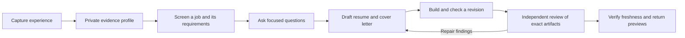

# Career Evidence Flow

**A private evidence database and agent workflows for finding jobs and preparing applications.**

Capture your experience once, keep its sources, and reuse it across job searches,
tailored resumes and cover letters. Career Evidence Flow gives **Codex, Claude Code and Hermes**
a shared workflow: maintain your private profile, screen opportunities, ask focused
questions, draft supported claims, and obtain independent reviews.

Your profile, answers and generated documents live in your own workspace. The
repository ships the tools, agent skills and fictional examples needed to start.

[Get started](#get-started) · [Try the designs](#try-it-with-fictional-data) ·
[Application workflow](docs/application-workflow.md) · [Host setup](docs/agent-hosts.md)

## What makes Career Evidence Flow useful

| Capability | What it does |
| --- | --- |
| **A reusable career evidence database** | Preserve experience, sources, ownership, dates, outcomes, limitations and corrections beyond any single resume. |
| **Job screening with practical constraints** | Save search preferences and assess location, remote work, work rights, citizenship, clearance, salary and application documents against available evidence. Unknowns stay explicit. |
| **Focused interviews before drafting** | Identify the few unanswered questions that could strengthen the application; reuse prior answers and capture new facts in the master profile. |
| **Tailoring from the full profile** | Select relevant depth and breadth within page limits, preserving chronology, attribution and project maturity. |
| **Purposeful cover letters** | Build a supported hiring argument, reuse genuine motivation and select the strongest examples. An explicit fluency pass reviews the introduction, transitions, sentence rhythm and natural reading before independent review. |
| **Independent review handoffs** | Give actual separate agents the evidence, job description, source text and exact artifacts to review facts, fit, persuasiveness, voice, skills and layout. |
| **Reproducible application bundles** | Use one CLI to render variants, run checks, freeze selected inputs and detect changed dependencies before review or handoff. |

The agent handles interpretation, interviews and writing. Local Python tools
handle validation, persistence and rendering. The tools need no API key; your
chosen agent host supplies its model, browsing and delegation capabilities.

## From experience to an application



The workflow reads the complete job description, records employer document and
AI-use instructions, and distinguishes direct experience from transferable
skills, coursework, unsupported claims and unknowns. Employer instructions
determine the deliverables. A no-letter instruction removes the letter.

Each stage is described in an installed agent skill. Hooks provide advisory
entry and continuation context; the host agent invokes commands and coordinates
reviewers. Installing a hook does not prove that the host has loaded it or that
a review occurred.

## Get started

Use Python **3.11 or newer** and an installed, configured coding agent. Clone this
repository using the HTTPS URL in GitHub's **Code** menu, open its directory and
run the installer for your host:

```text
python install.py codex
python install.py claude
python install.py hermes
```

Choose one command, or run them sequentially for multiple hosts. On macOS/Linux,
use `python3` if that is your Python 3.11+ executable. Each command creates or reuses
one project environment under `.local/career-evidence-flow/venv`, installs this
checkout and its Python dependencies, binds the private `user-profile/` workspace,
installs the host's skills, and runs diagnostics. Repeat installs refresh unchanged
managed integrations; custom edits are reported for comparison rather than replaced.

Add `--hooks` to install advisory hook files, for example
`python install.py codex --hooks`. Previously managed hooks are refreshed on later
runs. Host trust, plugin activation and model/provider configuration stay explicit.
Use `--project PATH` for another existing project, `--workspace PRIVATE_CHILD` for
another contained data directory, or `--without-visual` to omit PDF page-image
dependencies. The installer does not install the coding agent itself.

Existing installations made with older commands are adopted only when their files
match the current package. A customized integration, missing managed file or startup
guide pinned to another environment requires an explicit comparison before upgrade.
See [installer details and recovery](docs/deployment.md#one-command-host-installers).

For a manually managed Python environment, the original setup remains available:

**Windows / PowerShell**

```powershell
cd career-evidence-flow
python -m venv .venv
.venv/Scripts/python -m pip install ".[visual]"
.venv/Scripts/cv setup user-profile --host all --project-root .
.venv/Scripts/cv doctor --workspace user-profile --host all --project-root .
```

On **macOS/Linux**, use `.venv/bin/python` and `.venv/bin/cv` for the environment
commands above. Select one host with `--host codex`, `--host claude` or
`--host hermes`. The `visual` extra enables PDF page images; plain `pip install .`
omits that optional dependency. PDF rendering also needs local Chrome/Chromium.

Open the repository in your agent host and start with:

> Read RESUME_TOOLKIT.md and use its pinned environment and private user-profile
> workspace. Help me capture my real experience, then search for suitable jobs or
> tailor a resume and cover letter to the full job description I provide. Reuse
> saved answers, ask focused questions where they matter, and run independent
> reviews when available. Follow the employer's document and AI-use instructions.

`setup` installs the shared skills and writes the local workspace binding. A new
profile starts empty; the agent captures actual facts before drafting. Setup
preserves valid existing data and does not automatically activate hooks or grant
host trust. See [portable installation](docs/deployment.md) for wheels, external
workspaces, host discovery, optional hooks and troubleshooting.

The public project is **Career Evidence Flow**. For compatibility, the Python distribution
remains `resume-toolkit`, its import is `cv_toolkit`, and its command is `cv`.
Install from this checkout or a built wheel; the project is not published to
PyPI. Below, `cv` means the executable from your chosen environment.

## Try it with fictional data

Render the same packaged two-page resume in **Editorial**, **Modern**, **Minimal**
and **ATS** styles:

```text
cv gallery --output outputs/resume-gallery --format both
```

Open `outputs/resume-gallery/index.html` to compare the designs. Use
`--format html` without Chrome/Chromium. For editable examples:

```text
cv init ../resume-demo --example showcase
cv init ../candidate-demo --example developer
cv validate-evidence --workspace ../candidate-demo
cv render --workspace ../candidate-demo --source resume.md --output outputs/resume.html
cv check --workspace ../candidate-demo --document outputs/resume.html
```

`--example researcher` provides another fictional background. All styles and
fixtures ship in the repository and wheel. You can develop and test the toolkit
without anyone else's profile. See [resume visuals](docs/resume-visuals.md).

## The reusable application commands

After the agent freezes the job, maps its requirements, resolves material
questions and writes supported Markdown, it uses these commands as part of the
[drafting and review workflow](skills/application-materials/references/drafting-workflow.md#rendering-and-checks):

```text
cv application-context --workspace ROOT --application applications/SLUG
cv build-application --workspace ROOT --application applications/SLUG --output outputs/SLUG/r01
cv verify-bundle --workspace ROOT --bundle outputs/SLUG/r01/bundle.json
```

- **Inspect:** validate standard inputs and identify pending questions and requirement gaps.
- **Build:** render policy-selected ATS/branded resumes and a cover letter, run checks, and save frozen inputs plus a review packet in a new output revision.
- **Verify:** detect changed or missing selected inputs, package assets and generated artifacts before review and handoff.

Repeat `--include` on the build command for actual source documents, prior
answers, writing preferences and support notes consulted. Add `--page-images` to
rasterize every PDF page, or use `--format html` for an HTML-only preview.
Source selection still needs review: hashes cannot establish semantic
completeness. See [records and commands](docs/workflow.md) for frozen jobs,
evidence, questions, answers, policy and corrections.

## One set of skills across three hosts

| Skill | Role in the workflow |
| --- | --- |
| [experience-capture](skills/experience-capture/SKILL.md) | Interview or import real experience with provenance, ownership and limitations. |
| [job-search](skills/job-search/SKILL.md) | Find and screen jobs; retain preferences, eligibility unknowns and application requirements. |
| [application-materials](skills/application-materials/SKILL.md) | Orchestrate the job-to-resume-and-letter workflow and its review handoffs. |
| [resume-review](skills/resume-review/SKILL.md) | Independently review evidence, job alignment, voice, skills, ATS extraction and page layout. |
| [cover-letter-review](skills/cover-letter-review/SKILL.md) | Independently review facts, persuasiveness, motivation, employer relevance, consistency and layout. |

Canonical skills live in `skills/`. Generated copies use `.agents/skills/` for
Codex and `.claude/skills/` for Claude Code; setup installs `.hermes/skills/` for
Hermes. [AGENTS.md](AGENTS.md) and [CLAUDE.md](CLAUDE.md) are the repository
entrypoints. After updates, compare installed skills and hook copies with the
current package: updating repository source alone does not refresh copied hooks.

## Your profile stays separate from the public project

```text
user-profile/                 Entire directory is Git-ignored
  profile/                    Canonical evidence, sources and preferences
  applications/               Separate records and editable drafts for each job
  outputs/                    Generated documents, bundles and review notes
```

An external private workspace is also supported. Back up your profile separately;
cloning Career Evidence Flow reproduces the tools and fictional examples. Your agent host
may send selected context to its configured model provider, so its privacy and
provider settings still apply. See [privacy and publication checks](docs/privacy.md).

## What the checks establish

The tools validate evidence joins, frozen job bytes, requirements, questions and
document limits. PDF checks expose text extraction and page-balance observations;
actual visual inspection is still required. Independent reviews require real
separate agents and must be reported unavailable when the host cannot provide them.

Outputs remain **previews**. Selected-file freshness does not authenticate a
reviewer, prove every claim, or authorize submission. Exhaustive claim maps,
authenticated review records and guarded release of reviewed bytes are unfinished;
`cv status` reports `draft_only` and `release_available: false`. See
[review and release](docs/review-and-release.md). Native host execution must be
verified separately from installing files or testing adapters.

## Develop and contribute

```text
python -m pytest -q
python tools/sync_skills.py --check
```

Edit skill policy only in `skills/`, then regenerate copies with
`python tools/sync_skills.py`. Keep personal data and outputs out of commits and
scan proposed public files with an external private denylist. See
[contributing](CONTRIBUTING.md). No open-source license has been selected.
